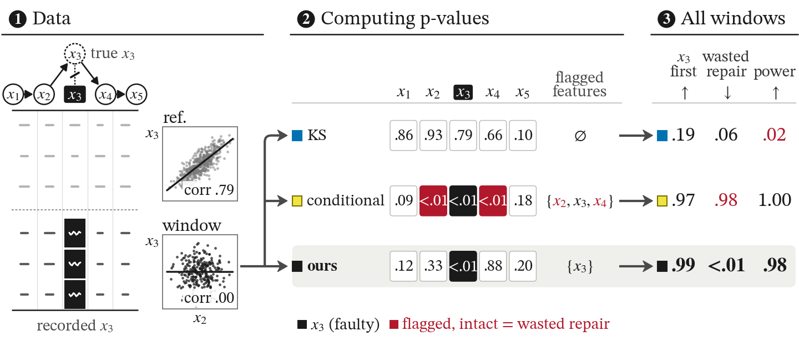

# Good Rankers, Wasted Repairs: Feature-Shift Localisers and the Repairs They Waste

Code and results of the paper (ESANN 2027, under review).

A feature-shift localiser compares a reference sample with a recent window and names the features in which a shift
originates. Each intact feature it names is a wasted repair. This repository scores localisers by their wasted-repair
rate, with power beside it, on five testbeds, and contains the leave-one-out conformal localiser used as a reference.



*A fault replaces the recorded x3. The conditional test also flags the intact x2 and x4; ours flags only x3.*

Testbeds, scoring rule and localiser settings: [`DETAILS.md`](DETAILS.md).

## Install

```bash
python -m venv .venv && source .venv/bin/activate   # Python 3.12
pip install -r requirements.txt
```

## Figures and numbers of the paper

The scored results are in `results/` (one CSV per testbed), so nothing needs to be rerun:

```bash
paper/make_all.sh     # Figures 1 to 3 -> paper/out/, the per-setting table and every number quoted in the text
```

Each CSV row is one setting (`type`, `mag`, window `w`) of one `localiser`: `rate` is the wasted-repair rate with its
bounds over `n_units` units, `verdict` is within / above / undetermined, then `power` and `hit1`.

## Rerunning the experiments

```bash
scripts/download_data.sh          # CATS, L-Town, Causal Chambers and ARM's arm_core.py, about 2 GB, checksums verified
scripts/setup_fslnet.sh           # FSL-Net in its own environment; prints FSLNET_PYTHON
export FSLNET_PYTHON=... LTOWN_PYTHON=...   # L-Town needs requirements-ltown.txt
scripts/run_experiments.sh 8      # 8 parallel jobs, about 30 CPU-hours; rewrites results/
```

One unit alone:

```bash
python -m wasted_repairs.run --testbed graphs --dataset lin5 --seed 4000 --localisers KS,COND,LOO
```

Localisers: `KS`, `ARM`, `COND` (conditional test), `CLF` (classifier), `FSL` (FSL-Net), `KS_B` and `COND_B`
(block-calibrated), `LOO` (ours).

## Citation

```bibtex
@inproceedings{goodrankers2027,
  title     = {Good Rankers, Wasted Repairs: Feature-Shift Localisers and the Repairs They Waste},
  author    = {De Melo Costa, Jos{\'e} Lucas and Pinto Sousa, Marcos Levi and Pedroso, Murilo and Rimmel, {\'A}rp{\'a}d and Popineau, Fabrice and Doan, Bich-Li{\^e}n},
  booktitle = {European Symposium on Artificial Neural Networks, Computational Intelligence and Machine Learning (ESANN)},
  year      = {2027},
  note      = {Under review}
}
```

## Licence

MIT (see `LICENSE`). Third-party data and code keep their licences: CATS, L-Town and Causal Chambers data CC BY 4.0,
the `causalchamber` package MIT, ARM's `arm_core.py` CC BY 4.0, FSL-Net CC BY-NC 4.0.
